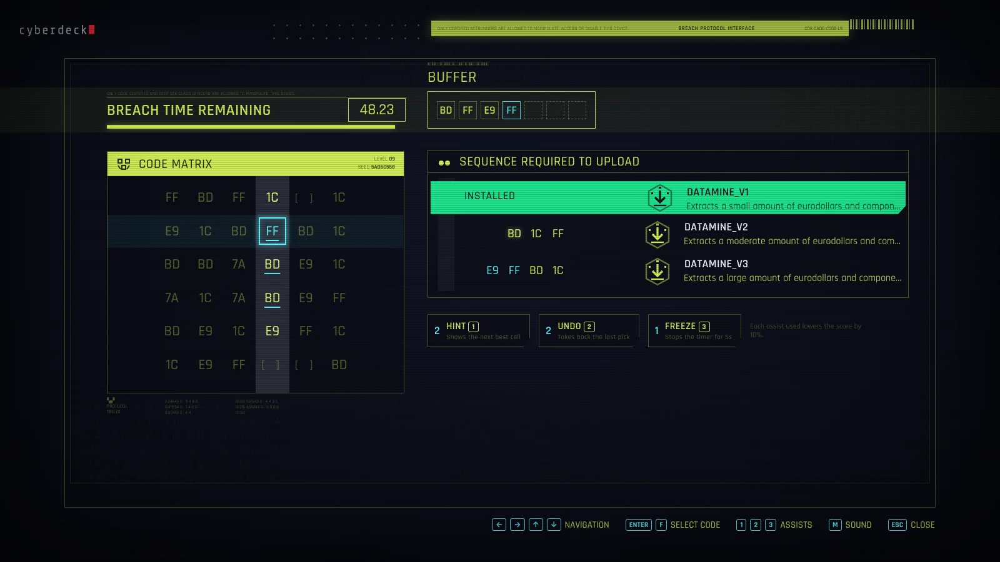
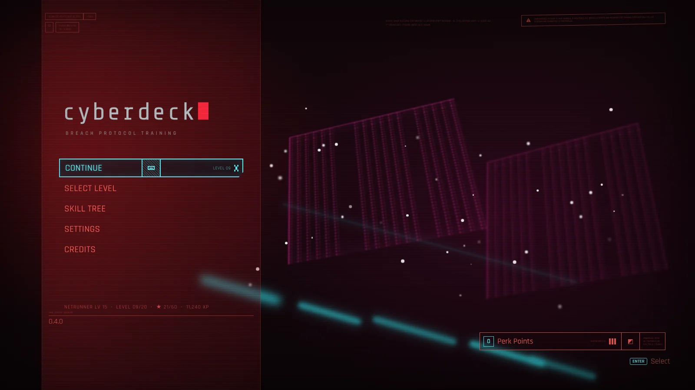
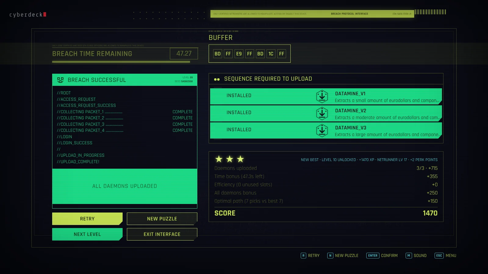
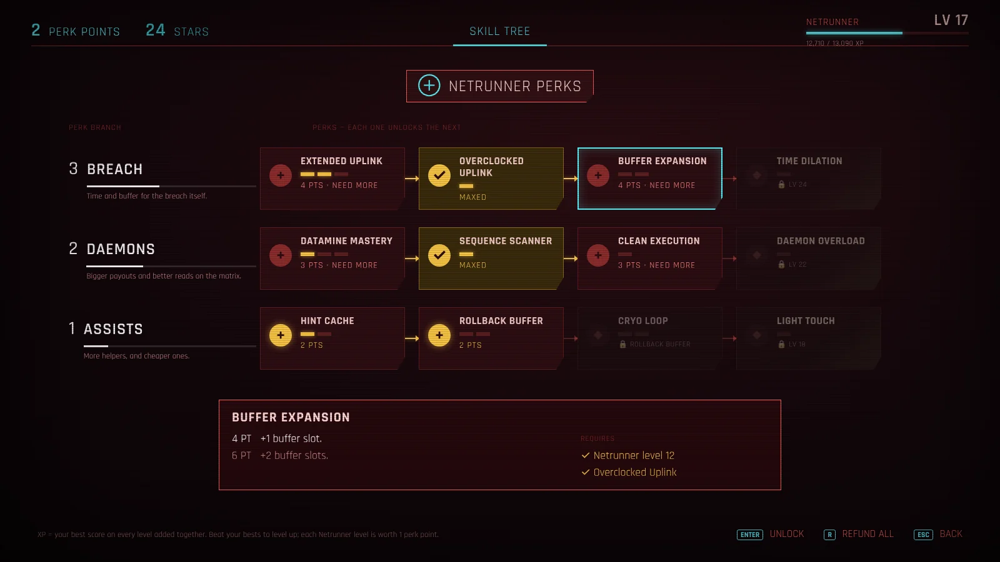
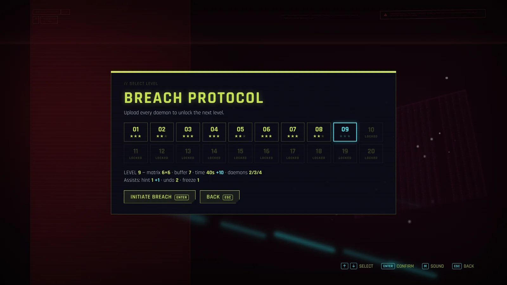

<p align="center">
  <picture>
    <source media="(prefers-color-scheme: dark)" srcset="src/assets/brand/cyberdeck-wordmark-light.svg">
    
  </picture>
</p>

<p align="center">
  <strong>Breach Protocol training environment, modelled on the Cyberpunk 2077 patch 2.0 hacking minigame.</strong>
</p>

<p align="center">
  <a href="https://bfailach.github.io/Cyberdeck/"></a>
  <a href="https://github.com/bfailach/Cyberdeck/actions/workflows/deploy-pages.yml"></a>
  
  
</p>

---

Cyberdeck reproduces the Breach Protocol interface and rules from Cyberpunk 2077 as a standalone application, so the minigame can be practised outside the game. Every puzzle is procedurally generated and verified solvable, scored against the solver's optimal solution, and tied into a 20-level difficulty curve and a Netrunner progression system. It runs in any modern browser and as an Electron desktop application.

**Live version:** https://bfailach.github.io/Cyberdeck/



<table>
  <tr>
    <td width="50%"><br><sub>Main menu</sub></td>
    <td width="50%"><br><sub>Breach result and score breakdown</sub></td>
  </tr>
  <tr>
    <td width="50%"><br><sub>Netrunner skill tree</sub></td>
    <td width="50%"><br><sub>Level select</sub></td>
  </tr>
</table>

## Contents

- [Features](#features)
- [Rules](#rules)
- [Controls](#controls)
- [Scoring](#scoring)
- [Difficulty curve](#difficulty-curve)
- [Progression](#progression)
- [Audio](#audio)
- [Architecture](#architecture)
- [Getting started](#getting-started)
- [Testing](#testing)
- [Deployment](#deployment)
- [Project structure](#project-structure)
- [Roadmap](#roadmap)
- [Credits and legal](#credits-and-legal)

## Features

- Interface replicating the in-game Breach Protocol screen: code matrix with active row and column highlighting, buffer, breach timer, daemon list with live alignment, and the result terminal.
- Patch 2.0 rules, with an optional setting that delays the timer until the first selection, as in the game.
- Procedural puzzle generator that guarantees every daemon can be uploaded, backed by an exact solver that computes the optimal path for each puzzle.
- 20 levels that scale matrix size (5×5 to 7×7), code alphabet, buffer slack, timer, daemon count and length, and available assists.
- Scoring against the optimal solution, with a three-star rating per level.
- Practice assists (hint, undo, timer freeze), each one reducing the final score.
- Netrunner progression: XP derived from best scores, Netrunner levels, and a chained skill tree with level- and star-gated capstones.
- Synthesized audio: an original soundtrack and interface sound effects generated in real time with the Web Audio API. No audio files are shipped.
- Keyboard-first input with full mouse support. On-screen key prompts are clickable.
- Resolution-independent rendering: a fixed 1600×900 logical stage scaled to the window, with backgrounds extended to fill any aspect ratio.
- Local persistence of progress, perks and settings. No account or server required.

## Rules

| Rule | Behaviour |
|---|---|
| First selection | Must come from the top row of the matrix. |
| Alternation | Each selection switches the active line: column of the previous cell, then row, then column, and so on. A cell can be used once. |
| Buffer | Every selection appends its code to the buffer, which has a fixed number of slots. |
| Upload | A daemon is installed when its full sequence appears in the buffer as consecutive codes. Sequences may overlap. |
| Failure | A daemon fails as soon as its remaining codes can no longer fit in the free buffer slots. |
| End of breach | The buffer is full, the timer reaches zero, every daemon is resolved, or no selectable cell remains. |
| Timer | Starts when the breach opens. Settings can switch it to start on the first selection (patch 2.0 behaviour). |

## Controls

| Input | Action |
|---|---|
| Arrow keys / WASD | Move the cursor along the active row or column |
| Enter / F / Space | Select the highlighted code |
| 1 / 2 / 3 | Hint / Undo / Freeze timer |
| Esc | Close the breach (counts as failed); return to the previous menu |
| R / N | Retry the same puzzle / generate a new puzzle (result screen) |
| R | Refund all perks (skill tree) |
| M | Mute or unmute audio |
| F11 | Toggle fullscreen (desktop application) |
| Mouse | Hover to preview a selection, click to select. Key prompts act as buttons. |

## Scoring

```
subtotal = daemon points + time bonus + efficiency + all-daemons bonus + optimal-path bonus
score    = round(subtotal × max(0, 1 − assists used × assist penalty))
```

| Component | Value |
|---|---|
| Daemon points | DATAMINE_V1 100, DATAMINE_V2 200, DATAMINE_V3 300, ICEPICK 300, plus 50 per code beyond three |
| Time bonus | 5 per second remaining (awarded only if at least one daemon is installed) |
| Efficiency | 50 per unused buffer slot (awarded only if at least one daemon is installed) |
| All-daemons bonus | 250 |
| Optimal-path bonus | 150 when every daemon is installed in no more selections than the solver's optimum |
| Assist penalty | 10% of the subtotal per assist used |

Ratings: one star for at least one daemon, two stars for all daemons, three stars for all daemons on an optimal-length path with no assists. Installing every daemon unlocks the next level.

## Difficulty curve

| Level | Matrix | Codes | Buffer | Timer (s) | Daemon lengths | Hint / Undo / Freeze |
|---|---|---|---|---|---|---|
| 1–2 | 5×5 | 5 | 6 | 60–58 | 2 / 3 / 3 | 3 / 3 / 2 |
| 3–4 | 5×5 | 5 | 7 | 55–53 | 2 / 3 / 3 | 3 / 3 / 2 |
| 5–6 | 6×6 | 5 | 7 | 50–48 | 2 / 3 / 4 | 2 / 3–2 / 2 |
| 7 | 6×6 | 5 | 6 | 45 | 2 / 3 / 4 | 2 / 2 / 1 |
| 8–9 | 6×6 | 5 | 7 | 43–40 | 2 / 3 / 4 | 2–1 / 2 / 1 |
| 10–12 | 7×7 | 6 | 7 | 38–33 | 3 / 3 / 4 | 1 / 2–1 / 1 |
| 13–14 | 7×7 | 6 | 8 | 30–28 | 3 / 3 / 4 | 0 / 1 / 0 |
| 15 | 7×7 | 6 | 8 | 25 | 3 / 3 / 4 / 4 | 0 / 1 / 0 |
| 16–20 | 7×7 | 6 | 8 | 25 | 3 / 3 / 4 / 4 | 0 / 0 / 0 |

Buffer slack (slots beyond the planted solution) is one slot up to level 6 and zero afterwards. From level 15 a fourth daemon, ICEPICK, is added.

## Progression

**XP** is the sum of the best score recorded on each level. A replay adds XP only when it improves on that level's best, so repeated play of easy levels does not advance progression.

**Netrunner level** is derived from total XP. The cumulative XP required for level *n* is:

```
XP(n) = 600 · (n − 1) + 10 · (n − 1)²
```

Each Netrunner level grants one perk point. Typical pacing: about 8 points after the first five levels, 16 at 13,000 XP, and about 41 at full mastery.

**Skill tree.** Each branch is a chain: a perk requires the previous perk in its branch (sometimes at a specific tier), a minimum Netrunner level, and, for capstones, a minimum number of stars. The complete tree costs 69 points, more than full mastery provides, so builds involve trade-offs. All points can be refunded at any time.

| Branch | Perk (cost per tier) | Requirement | Effect |
|---|---|---|---|
| Breach | Extended Uplink (2 / 3 / 4) | Level 1 | +5 / +10 / +15 s breach time |
| | Overclocked Uplink (3) | Level 6, Extended Uplink 2 | Time bonus × 1.5 |
| | Buffer Expansion (4 / 6) | Level 12, Overclocked Uplink | +1 / +2 buffer slots |
| | Time Dilation (7), capstone | Level 24, 36 stars, Buffer Expansion 1, Extended Uplink 3 | Breach timer runs 20% slower |
| Daemons | Datamine Mastery (2 / 3 / 4) | Level 1 | Daemon points +10 / +20 / +30% |
| | Sequence Scanner (3) | Level 5, Datamine Mastery 1 | Marks active-line codes that advance a daemon |
| | Clean Execution (3) | Level 10, Sequence Scanner | Optimal-path bonus 300 |
| | Daemon Overload (7), capstone | Level 22, 36 stars, Clean Execution, Datamine Mastery 3 | All-daemons bonus 500 |
| Assists | Hint Cache (1 / 2) | Level 1 | +1 / +2 hints per breach |
| | Rollback Buffer (2 / 3) | Level 3, Hint Cache 1 | +1 / +2 undos per breach |
| | Cryo Loop (2 / 3) | Level 8, Rollback Buffer 1 | +1 freeze; freeze lasts 8 s at tier 2 |
| | Light Touch (5), capstone | Level 18, 24 stars, Cryo Loop 1, Hint Cache 2 | Assist penalty 5% |

Saves created under earlier progression rules are validated on load. Perks that no longer satisfy the rules are refunded; levels, stars and scores are preserved.

## Audio

All audio is synthesized at runtime with the Web Audio API.

- **Soundtrack.** "Black ICE" is an original track written for this project: 148 BPM, E Phrygian, 32-bar arrangement (intro, two drops, breakdown, outro). Instrumentation: saturated kick with sidechain-style ducking, detuned reese bass through an LFO-modulated low-pass filter and waveshaper, layered clap snare, industrial percussion, low swelling hits, and palm-muted power chords through a cabinet-style EQ chain. Notes are scheduled with a look-ahead sequencer. In menus the mix passes through a low-pass filter, which opens fully during a breach.
- **Sound effects.** Non-tonal interface sounds built from filtered-noise transients, sub-bass, metallic resonances (high-Q band-pass filters at inharmonic ratios), and a convolution reverb.
- **Custom soundtrack.** Settings → Load music file plays an audio file selected by the player. The file is stored only in the browser's IndexedDB on that machine and is never uploaded or committed. Known tracks are credited automatically on the Credits screen.

## Architecture

The game is plain JavaScript (ES modules) bundled by Vite. It has no runtime framework and one runtime dependency (the Rajdhani font). The game rules are kept separate from the interface code, so they run and are tested in Node without a browser.

| Module | Responsibility |
|---|---|
| `src/engine/rules.js` | Active-line computation, selectable cells, daemon state (installed, pending, failed), end-of-breach detection |
| `src/engine/generator.js` | Seeded puzzle generation with a solvability guarantee |
| `src/engine/solver.js` | Exact search for the optimal continuation from any state |
| `src/engine/breach.js` | Breach state machine: selections, timer, assists, perk modifiers, final scoring |
| `src/engine/scoring.js` | Score formula and star rating |
| `src/engine/levels.js` | Difficulty curve |
| `src/engine/perks.js` | XP, Netrunner levels, skill tree, requirement checks, perk modifiers |
| `src/engine/rng.js` | Seeded PRNG (mulberry32), so a puzzle can be replayed from its seed |
| `src/main.js` | Screens, input handling, rendering, game loop |
| `src/ui/music.js`, `src/ui/sfx.js`, `src/ui/audio.js` | Soundtrack sequencer, sound effects, audio routing and volume |
| `src/storage.js`, `src/musicStore.js` | Save data (localStorage) and the player's custom track (IndexedDB) |

**Puzzle generation.** For a given level and seed, the generator:

1. Draws a random solution string *S* whose length is the level's planted solution length.
2. Cuts each daemon out of *S* at random offsets. The cuts together must cover the whole of *S*, every daemon must be distinct, and no daemon may be contained in another. Overlapping cuts produce sequences that chain into each other, as in the game.
3. Embeds *S* along a random legal selection path (top row first, then alternating column and row) and fills the remaining cells with random codes from the level's alphabet.
4. Runs the solver and accepts the puzzle only if every daemon can be installed and the optimal solution is no more than one selection shorter than the planted path.

Rejected candidates are regenerated, up to 200 attempts per puzzle.

**Solver.** An iterative-deepening depth-first search over legal selection sequences. It finds the maximum achievable daemon value with the fewest selections. Branches are pruned as soon as the installed value plus every daemon that can still fit cannot reach the target. The same routine powers the in-game hint, which searches from the player's current position. Generation and verification take about 0.5 ms per puzzle at level 1 and about 3.5 ms at level 20 (Node 22, single thread).

**Rendering.** The interface is laid out on a fixed 1600×900 logical stage and scaled to the window, centered. Full-screen layers (backgrounds, the menu panel, scan lines, vignette) extend beyond the stage, so windows of any aspect ratio are covered without letterboxing. The desktop window opens at a 1600×900 content size and keeps 16:9 when resized.

**Persistence.** Progress, best scores, perks and settings are stored in `localStorage` under `cyberdeck.save.v1`. Saves are per browser profile; the desktop application and each browser keep separate saves.

## Getting started

Requirements: Node.js 20 or later (22 LTS recommended) and npm.

```bash
git clone https://github.com/bfailach/Cyberdeck.git
cd Cyberdeck
npm install
```

| Command | Description |
|---|---|
| `npm run dev` | Development server with hot reload at http://localhost:5173 |
| `npm run build` | Production build to `dist/` |
| `npm run preview` | Serve the production build locally |
| `npm run app` | Build and launch the Electron desktop application |
| `npm test` | Run the engine test suite |

`npm run app` first runs `scripts/ensure-electron.cjs`, which downloads the Electron runtime from the official GitHub releases if npm did not install it. Some npm and Node versions skip or interrupt Electron's own install step. On Windows the download uses PowerShell.

## Testing

The engine is covered by tests that run with Node's built-in runner (`node --test`), with no extra dependencies:

- selection rules, alternation and buffer behaviour;
- daemon upload and failure conditions;
- solver correctness, using a reference puzzle taken from the game;
- solvability of generated puzzles at all 20 levels, replaying each optimal path;
- seed determinism;
- timer modes, freeze and time dilation;
- scoring with perk modifiers;
- the XP curve, perk requirements, and validation of old saves.

## Deployment

`.github/workflows/deploy-pages.yml` builds the project on every push to `main`. It runs the tests, produces the production build, and publishes `dist/` to GitHub Pages. A failing test blocks the deployment. The Vite build uses relative asset paths, so the same output works on the Pages subpath, on any static host, and inside the Electron application.

## Project structure

```
.github/workflows/   GitHub Pages build and deployment
build/               Desktop application icons (png, ico, icns)
docs/                Social preview image and README screenshots
electron/            Electron main process
scripts/             Electron runtime installer
src/
  assets/brand/      Wordmark and application icon (SVG)
  engine/            Game rules, generator, solver, scoring, levels, perks
  ui/                Styles, soundtrack, sound effects, audio routing
  main.js            Screens, input, rendering, game loop
  storage.js         Save data
  musicStore.js      Custom soundtrack storage
test/                Engine tests
index.html           Application shell
```

## Roadmap

- Additional daemon types and perk effects
- Packaged desktop installers for Windows, macOS and Linux (electron-builder)
- Gamepad input

## Credits and legal

Created by Bryan Failach.

- Soundtrack and sound effects: original, synthesized for this project.
- Fonts: Rajdhani by Indian Type Foundry and Share Tech Mono by Carrois Type Design, both under the SIL Open Font License.

Cyberdeck is a non-commercial fan project. It is not affiliated with or endorsed by CD PROJEKT RED. Cyberpunk 2077 is a trademark of CD PROJEKT S.A. No game assets are included; all interface artwork, icons, and audio in this repository are original.
